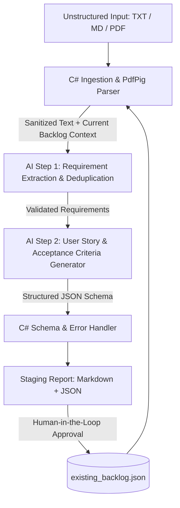

# Smart Backlog Assistant — Project Plan

Building the **Smart Backlog Assistant** in .NET 10 (`net10.0`) using `Microsoft.Extensions.AI` and Azure OpenAI aligns directly with your enterprise client stack and your Azure enablement pathway for the Full Stack FDE certification. This plan structures your capstone around an AI-First SDLC paradigm: deterministic C# code handles file ingestion, PDF parsing, and schema validation, while the LLM handles unstructured requirement extraction, deduplication reasoning, and user story generation.

---

## Step 1: Problem Definition

### Problem Statement
Engineering teams lose significant velocity translating unstructured discovery notes, noisy meeting transcripts, and PDF specs into standardized, non-duplicate backlog items.

1. **Use Case 1** a simple CLI that implements the current process described in practical process as-is v1.

2. **Use Case 2** (Noisy Meeting Transcripts):** Ingest raw MS Teams sprint planning transcripts, filter out conversational filler, and extract actionable user stories with clear acceptance criteria.

3. **Use Case 3** (Technical Spec Decomposition):** Parse requirement PDFs into categorized engineering tasks with suggested priority levels (P0 to P3).

4. (Backlog Deduplication):** Cross-reference newly extracted requirements against an existing JSON backlog to flag overlapping tickets before creating duplicates.

5. **AI in Problem Framing:** Document how you used an LLM acting as a Senior Technical PM to stress-test edge cases and refine these three use cases.

---

## Step 2: Solution Design & Architecture

### practical process as-is v1

```mermaid
swimlane-beta TB
  subgraph local
    collect[Collect raw data]
    process[add to Copilot with pre-designed prompt]
    validate[copy outcome]
  end

  subgraph Review
    review[Review outcome]
    decide{backlog type?}
  end

  subgraph Jira
    complete[use given When Then]
    schedule[use title + description]
  end

  collect --> process --> validate --> review --> decide
    decide -->|Type01| complete
    decide -->|Type02| schedule
```

* **Ingestion Service (Deterministic C#):** Reads raw text files or extracts text from PDFs using the `PdfPig` NuGet package, and loads the existing JSON backlog via `System.Text.Json`.
* **Sequential Prompting Engine (`Microsoft.Extensions.AI`):** Uses `IChatClient` to execute a two-stage reasoning chain—first extracting and deduplicating core requirements, then formatting user stories.
* **Structured Output Enforcement:** Uses `GetResponseAsync<BacklogAnalysisResult>()` to bind the LLM response directly to strongly typed C# records, eliminating malformed JSON.
* **Human-in-the-Loop Gate:** Outputs the proposed stories to the console and a staging Markdown file, requiring engineer confirmation before updating the JSON backlog.



* **Prompt Design Strategy:** Combine a Senior Technical Project Manager persona with step-by-step Chain-of-Thought instructions and a strict Zero Hallucination clause forbidding invented owners or dates.

---

## Step 3: Testing Approach

* **Scenario 1 (Discovery Transcript):** Create a sample MS Teams transcript containing small talk, conflicting opinions, and three concrete feature decisions.
* **Scenario 2 (Requirement PDF):** Create a short technical PDF describing an authentication or cloud migration feature with explicit security constraints.
* **Scenario 3 (Duplicate Detection):** Provide a requirement note that overlaps 80 percent with an item already inside your sample JSON backlog.
* **Definition of Good Output:** Verify that each run produces a concise requirement summary, "As a / I want / So that" user stories, Gherkin or bulleted acceptance criteria, P0–P3 priorities, and accurate duplicate flags.

---

## Step 4: Implementation Blueprint (.NET 10)

1. **Scaffold the Solution:** Run `dotnet new console --name SmartBacklogAssistant --framework net10.0` and add packages for `Microsoft.Extensions.AI`, `Microsoft.Extensions.AI.OpenAI`, `Azure.AI.OpenAI`, `PdfPig`, and `Microsoft.Extensions.Logging.Console`.
2. **Define C# Domain Records:** Create immutable `record` types (`BacklogAnalysisResponse`, `UserStoryDto`, `ExistingTicketDto`) annotated with `System.ComponentModel.Description` attributes to guide the AI schema generator.
3. **Build Resilient AI Calls:** Wrap `IChatClient` calls in `try/catch` blocks handling `ClientResultException` and network timeouts so rate limits or missing API keys fail gracefully with clear log messages.
4. **Add Observability Logging:** Use `ILogger` to log each pipeline stage (Document Loaded, Prompt Stage 1 Sent, Structured Output Parsed, Token Usage) to demonstrate process visibility to reviewers.
5. **Secure Configuration:** Load `OPENAI_API_KEY` or `AZURE_OPENAI_ENDPOINT` via .NET User Secrets or `.env` templates injected via 1Password CLI so zero credentials exist in source control.

---

## Step 5: Documentation & Reviewer Package

* **Reviewer-Friendly README:** Include architecture diagrams, prerequisites (.NET 10 SDK and API key setup), and one-line `dotnet run -- --input samples/meeting-notes.txt --backlog samples/backlog.json` test commands.
* **Prompt Engineering Log:** Document your v1 (monolithic prompt) versus v2 (role-based sequential prompt with structured output schema) to prove iterative prompt refinement.
* **AI-Assisted Development Evidence:** Include a section detailing how AI tools assisted in generating boilerplate C# records, unit test fixtures, and regex/PDF text sanitization during coding.
* **Reflection & Future Roadmap:** Discuss what worked well (type-safe structured outputs via `Microsoft.Extensions.AI`) and propose an Evaluator-Optimizer agent loop or MCP server integration as your next iteration.

---

## Step 6: Ergonomic CLI & TUI Standards ([Issue #3](https://github.com/aleon1220/fde-sharp-backlog/issues/3) · [Issue #5](https://github.com/aleon1220/fde-sharp-backlog/issues/5) · [Issue #7](https://github.com/aleon1220/fde-sharp-backlog/issues/7) · [Milestone #1 `release-fde-version`](https://github.com/aleon1220/fde-sharp-backlog/milestone/1))

### 1. Evaluation of Contemporary CLI & TUI Tools
* **Gemini CLI / Antigravity (`agy`):** Establishes interactive REPL ergonomics with a compact boxed workspace header, `/slash` commands, `@filename` context mentions, and progressive disclosure into submenus without sacrificing zero-config simplicity.
* **Astral `uv` (Python):** Sets the bar for fast verb-driven subcommands (`process`, `draft`, `status`, `config`, `models`), elapsed step timers (`✓ Resolved ... in 1ms`), non-intrusive Braille progress spinners, actionable error + `hint:` messages, and scannable per-command `--help`.
* **`kubectl` (Kubernetes CLI):** Establishes predictable resource/verb ergonomics, `-o` / `--output <md|json|both>` / `--json` format flags, `--dry-run` / `--preview` safe previews, and environment pre-flight diagnostics (`status` / `doctor`).

### 2. Ergonomic Terminal Standards & Multi-Provider Orchestration Implemented on `feature/cli-overhaul`
1. **Astral `uv`-Style Subcommands (Headless Speed):**
   * `process [all | <file>] [--dry-run] [--json]` (alias `run`): Processes queued `.txt`/`.md` files in `./in` or a targeted file.
   * `draft "<Goal or Title>" [--type <01|02|both>] [--preview]` (alias `add`): Generates Type `01` (User Story + GWT), Type `02` (Schedule Item), or `both` without blocking stdin.
   * `status` (alias `doctor`): Renders a crisp, color-coded Unicode table of WSL2/Windows resolved paths, queued `./in` count, export state, Gemini API key status, and AI Provider Matrix.
   * `config [--json <on|off>] [--in <path>] [--out <path>] [--theme ...] [--provider ...] [--verbosity <min|bal|det>]`: Non-interactively updates persisted workspace settings in `smart-backlog-assistant/settings.json` (including `defaultVerbosity`).
   * `models` & `version`: Inspects supported models for active provider (`gemini` or `copilot-sdk`) and build metadata.
2. **Gemini CLI / Agy Interactive REPL & Unified Wizard Orchestrator:**
   * Boxed workspace status header (`In: ./in | Out: ./out | Export: .md (JSON: ON/OFF)`) + provider/live/verbosity/theme telemetry bar.
   * Unified Main Menu `[0-5]` starting with `[1]` / `w` **Wizard Orchestrator** (`wizard > `), compact aligned options (`descWidth = 36`), quick shortcuts (`[w/d/p/v/s/c/?/q]`), universal `[0/b/back]` and `[q/quit]` navigation, `/slash` commands (`/wizard`, `/process`, `/draft`, `/preview`, `/copy`, `/verbosity`, `/settings`, `/status`, `/config`, `/provider`, `/models`, `/theme`, `/json`, `/live`, `/help`, `/clear`, `/exit`), and `@filename` context mentions.
   * Wizard Orchestrator submenu (`[0-6]`) offers ALL capabilities in one hub: `[1]` Draft Goal / Title, `[2]` Process Input Files (`all`, `single` via `ProcessSingleFileInWizard`, or `dry`), `[3]` Preview, Refine & Copy saved `.md` (`OpenSavedMarkdownInWizardReview` using `MarkdownOutcomeRenderer.ReconstructOutcomeFromMarkdown`), `[4]` Quick Copy Last Outcome, `[5]` Workspace & Settings, `[6]` Status & AI Diagnostics, plus `[E]` promotion directly from `[4]` Preview & Copy into Wizard Review.
   * Settings submenu (`[1..9]`) with a compact 3-line summary header (`Paths`, `Active`, `Config`), `[3]` full Runtime & AI Diagnostics, `[4]` CLI Theme (`agy`, `uv`, `kubectl`), `[7]` View `settings.json`, `[8]` Select AI Provider, and `[9]` Default Outcome Verbosity (`Minimalistic <=25w`, `Balanced <=57w`, `Detailed <=95w`).
3. **`GitHub.Copilot.SDK` Multi-Provider Orchestration (`AiProviderOrchestrator`):**
   * Preserves `GoogleGemini` REST, `ManualPrompt`, `AzureOpenAi`, and `AnthropicClaude` zero-regression pipelines while adding `GitHubCopilot` (`GitHub.Copilot.SDK` `1.0.34`) native session routing and BYOK provider support.
4. **Simplified CLI Menu Framing & Verification Checks (`feature/simpler-format-cli-tui` · [Issue #11](https://github.com/aleon1220/fde-sharp-backlog/issues/11)):**
   * **User Value**: Scannability at a glance (compact 76-col rows + 3-line Settings summary instead of an 18-line diagnostic dump), fewer keystrokes (`w`/`/wizard` direct entry, `d/p/v/s/c/?/q`), and consistent `[b]ack`/`[q]uit` across all submenus and themed `[Key]` badges in `[4/5 Review Decision]`.
   * **Clear Success Criteria**: Verified via `CliMenuRunnerTests` covering main menu quick shortcuts, unified Wizard Orchestrator all-options hub, saved `.md` reconstruction/refinement, universal back/quit across submenus, and compact Settings header.
5. **Interactive Output Selector, Clean Text Extraction, & Cross-Platform OSC 52 Clipboard ([Issue #12](https://github.com/aleon1220/fde-sharp-backlog/issues/12)):**
   * **Interactive Selection (`InteractiveSelector`):** Live TTY arrow-key (`↑`/`↓`/type-to-filter/`Enter`/`Esc`) picker with line-based fuzzy filtering fallback for redirected/test streams across saved `.md` files and output formats/fields (`simple`, `raw`, `md`, `clean`, `title`, `story`, `desc`, `ac`, `alt1..alt3`).
   * **Clean `stdout` / `stderr` Pipeline Separation:** `backlog preview --select` routes interactive prompts and clipboard feedback to `stderr`, emits only the selected clean text to `stdout`, and exits gracefully with an actionable hint under `--non-interactive` or EOF streams.
   * **Cross-Platform Clipboard + OSC 52 Fallback (`OsClipboardService`):** Uses native utilities first and falls back to ANSI OSC 52 (`\e]52;c;<base64>\a` or `tmux` DCS passthrough) on compatible terminals.
6. **Simpler `Type01` & `Type02` CLI/TUI Output Format & Unified Review Hub ([Issue #8](https://github.com/aleon1220/fde-sharp-backlog/issues/8)):**
   * **Crisp Live vs. Saved Parity (`JiraBacklogFormatter`, `AsIsV1Workflow`):** `Type01` (`complete`) persists `Title`, `User Story`, concise `Description` (verbosity-aware: `Minimalistic <= 25w`, `Balanced <= 57w`, `Detailed <= 95w` with `*` bullets), `Acceptance Criteria (Given / When / Then)`, and `Alternatives`; `Type02` (`schedule`) stays strictly focused on `Title`, concise `Description`, and `Alternatives` without injecting `User Story` or `GWT` rows.
   * **Scannable Terminal Table (`MarkdownOutcomeRenderer`):** Strips raw `# [Jira - ...]`, `### `, and `**` syntax clutter from terminal display cells while preserving full Markdown in saved `.md` files and `md` clipboard exports, supports `[N]` Simple Unformatted Copy (`Title / --- / Description`), highlights semantic badges, and reconstructs saved `.md` outcomes (`ReconstructOutcomeFromMarkdown`) for Wizard re-refinement.
   * **Quiet-by-Default Pipeline Chrome (`AsIsV1Workflow`):** Emits compact `uv`-style step completion lines (`✓ Collected`, `✓ Expanded`, `✓ Generated`) before the outcome table, with `--verbose` (`/verbose`) available for deep runtime diagnostics.

