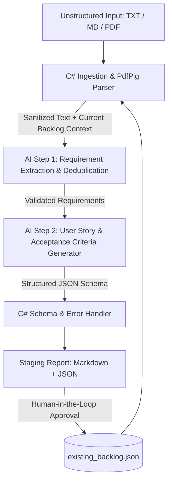

# Smart Backlog Assistant — Project Plan

Building the **Smart Backlog Assistant** in .NET 10 (`net10.0`) using `Microsoft.Extensions.AI` and Azure OpenAI aligns directly with your enterprise client stack and your Azure enablement pathway for the Full Stack FDE certification. This plan structures your capstone around an AI-First SDLC paradigm: deterministic C# code handles file ingestion, PDF parsing, and schema validation, while the LLM handles unstructured requirement extraction, deduplication reasoning, and user story generation.

---

## Step 1: Problem Definition

### Problem Statement
Engineering teams lose significant velocity translating unstructured discovery notes, noisy meeting transcripts, and PDF specs into standardized, non-duplicate backlog items.

1. **Use Case 1** a simple CLI that implements the current process described in practical process as-is v1.

2. **Use Case 2** (Noisy Meeting Transcripts):** Ingest raw MS Teams sprint planning transcripts, filter out conversational filler, and extract actionable user stories with clear acceptance criteria.

3. **Use Case 3** (Technical Spec Decomposition):** Parse requirement PDFs into categorized engineering tasks with suggested priority levels (P0 to P3).

4. (Backlog Deduplication):** Cross-reference newly extracted requirements against an existing JSON backlog to flag overlapping tickets before creating duplicates.

5. **AI in Problem Framing:** Document how you used an LLM acting as a Senior Technical PM to stress-test edge cases and refine these three use cases.

---

## Step 2: Solution Design & Architecture

### practical process as-is v1

```mermaid
swimlane-beta TB
  subgraph local
    collect[Collect raw data]
    process[add to Copilot with pre-designed prompt]
    validate[copy outcome]
  end

  subgraph Review
    review[Review outcome]
    decide{backlog type?}
  end

  subgraph Jira
    complete[use given When Then]
    schedule[use title + description]
  end

  collect --> process --> validate --> review --> decide
    decide -->|Type01| complete
    decide -->|Type02| schedule
```

* **Ingestion Service (Deterministic C#):** Reads raw text files or extracts text from PDFs using the `PdfPig` NuGet package, and loads the existing JSON backlog via `System.Text.Json`.
* **Sequential Prompting Engine (`Microsoft.Extensions.AI`):** Uses `IChatClient` to execute a two-stage reasoning chain—first extracting and deduplicating core requirements, then formatting user stories.
* **Structured Output Enforcement:** Uses `GetResponseAsync<BacklogAnalysisResult>()` to bind the LLM response directly to strongly typed C# records, eliminating malformed JSON.
* **Human-in-the-Loop Gate:** Outputs the proposed stories to the console and a staging Markdown file, requiring engineer confirmation before updating the JSON backlog.



* **Prompt Design Strategy:** Combine a Senior Technical Project Manager persona with step-by-step Chain-of-Thought instructions and a strict Zero Hallucination clause forbidding invented owners or dates.

---

## Step 3: Testing Approach

* **Scenario 1 (Discovery Transcript):** Create a sample MS Teams transcript containing small talk, conflicting opinions, and three concrete feature decisions.
* **Scenario 2 (Requirement PDF):** Create a short technical PDF describing an authentication or cloud migration feature with explicit security constraints.
* **Scenario 3 (Duplicate Detection):** Provide a requirement note that overlaps 80 percent with an item already inside your sample JSON backlog.
* **Definition of Good Output:** Verify that each run produces a concise requirement summary, "As a / I want / So that" user stories, Gherkin or bulleted acceptance criteria, P0–P3 priorities, and accurate duplicate flags.

---

## Step 4: Implementation Blueprint (.NET 10)

1. **Scaffold the Solution:** Run `dotnet new console --name SmartBacklogAssistant --framework net10.0` and add packages for `Microsoft.Extensions.AI`, `Microsoft.Extensions.AI.OpenAI`, `Azure.AI.OpenAI`, `PdfPig`, and `Microsoft.Extensions.Logging.Console`.
2. **Define C# Domain Records:** Create immutable `record` types (`BacklogAnalysisResponse`, `UserStoryDto`, `ExistingTicketDto`) annotated with `System.ComponentModel.Description` attributes to guide the AI schema generator.
3. **Build Resilient AI Calls:** Wrap `IChatClient` calls in `try/catch` blocks handling `ClientResultException` and network timeouts so rate limits or missing API keys fail gracefully with clear log messages.
4. **Add Observability Logging:** Use `ILogger` to log each pipeline stage (Document Loaded, Prompt Stage 1 Sent, Structured Output Parsed, Token Usage) to demonstrate process visibility to reviewers.
5. **Secure Configuration:** Load `OPENAI_API_KEY` or `AZURE_OPENAI_ENDPOINT` via .NET User Secrets or `.env` templates injected via 1Password CLI so zero credentials exist in source control.

---

## Step 5: Documentation & Reviewer Package

* **Reviewer-Friendly README:** Include architecture diagrams, prerequisites (.NET 10 SDK and API key setup), and one-line `dotnet run -- --input samples/meeting-notes.txt --backlog samples/backlog.json` test commands.
* **Prompt Engineering Log:** Document your v1 (monolithic prompt) versus v2 (role-based sequential prompt with structured output schema) to prove iterative prompt refinement.
* **AI-Assisted Development Evidence:** Include a section detailing how AI tools assisted in generating boilerplate C# records, unit test fixtures, and regex/PDF text sanitization during coding.
* **Reflection & Future Roadmap:** Discuss what worked well (type-safe structured outputs via `Microsoft.Extensions.AI`) and propose an Evaluator-Optimizer agent loop or MCP server integration as your next iteration.

---

## Step 6: Ergonomic CLI & TUI Standards ([Issue #3](https://github.com/aleon1220/fde-sharp-backlog/issues/3) · [Issue #5](https://github.com/aleon1220/fde-sharp-backlog/issues/5) · [Milestone #1 `release-fde-version`](https://github.com/aleon1220/fde-sharp-backlog/milestone/1))

### 1. Evaluation of Contemporary CLI & TUI Tools
* **Gemini CLI / Antigravity (`agy`):** Demonstrates progressive disclosure—launching an interactive TUI with a compact status bar (`model`, masked `API key`, active workspace, and active theme) when invoked with no arguments, while supporting single-shot headless execution for automation.
* **Astral `uv` (Python):** Sets the bar for action-first verb subcommands (`run`, `draft`, `models`, `doctor`, `version`), zero-config workspace discovery, and concise `[✓]` completion summaries.
* **`kubectl` (Kubernetes CLI):** Establishes predictable resource/verb ergonomics, `-o` / `--output <md|json|both>` format flags, `--dry-run` safe previews, and environment pre-flight diagnostics (`doctor` / `status`).

### 2. Ergonomic Terminal Standards Implemented on `feature/cli-overhaul`
1. **Hybrid TUI + Verb Subcommands:**
   * `menu` (or no args): Launches interactive colored TUI (`CliMenuRunner`).
   * `run` (or `process`): Processes raw discovery notes from `-i|--input` or workspace `./in`.
   * `draft <goal>` (or `add <goal>`): Generates `Type01` (`complete`), `Type02` (`schedule`), or `both` directly from a positional goal argument.
   * `models`: Lists Gemini models advertising `generateContent` for the active key.
   * `doctor` / `status`: Runs a non-destructive pre-flight check of OS/runtime, CLI theme, Windows/WSL workspace paths, prompt templates, and masked `GEMINI_API_KEY` status.
   * `version`: Prints deterministic build and runtime version metadata.
2. **Selectable CLI Themes (`agy` Default, `uv`, `kubectl`) in Configuration Sub-Menu:**
   * Interactive configuration sub-menu (`Workspace & Settings -> [4] Select CLI Theme`) and `--theme <agy|uv|kubectl>` flag supporting **`agy` style (default)**, **`uv` style**, and **`kubectl` style**, persisted in `smart-backlog-assistant/settings.json`.
3. **Short Flags & Output Selectors:**
   * `-i` (`--input`), `-p` (`--prompt`), `-t` (`--type <01|02|both>`), `-o` (`--output <md|json|both>`), `--theme <agy|uv|kubectl>`, `--dry-run`, and `-v` (`--version`), while preserving 100% backward compatibility with all existing `--*` flags.

